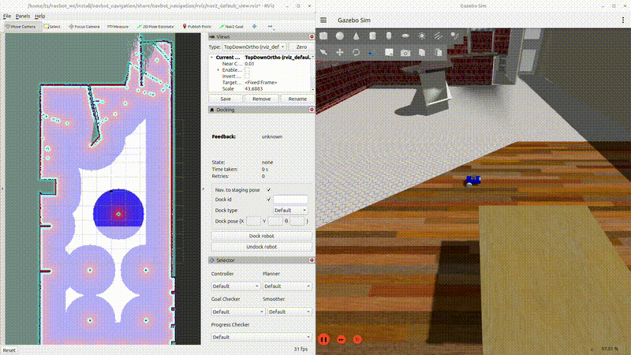
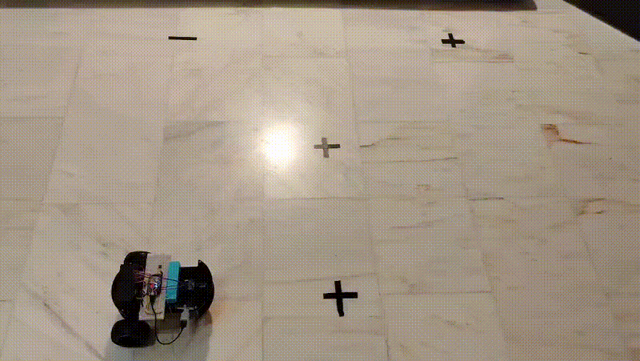

# NavBot | Autonomous Mobile Robot

<p align="center">
  <strong>ROS 2 · Gazebo · RViz · Nav2 · micro-ROS · ESP32</strong><br>
  A differential-drive robot developed across simulation and physical hardware.
</p>

<p align="center">
  <a href="#simulated-navigation-and-docking">Simulation</a> ·
  <a href="#physical-robot">Physical robot</a> ·
  <a href="#build-and-run-the-simulation">Build and run</a> ·
  <a href="#repository-map">Repository map</a>
</p>

## At a glance

NavBot is a ROS 2 robotics workspace for a custom differential-drive mobile robot. It brings together the robot model, simulation, navigation and localization stack, AprilTag-based dock perception, and an ESP32 firmware project using micro-ROS. The same project explores the system in Gazebo/RViz and on the real robot.

| Area | What it demonstrates |
| --- | --- |
| Robot model | Xacro/URDF description, sensors, ros2_control configuration, and RViz views |
| Simulation | Gazebo Sim worlds, robot spawning, controllers, and ROS–Gazebo topic bridges |
| Navigation | Nav2 goals, custom path planning/following, and velocity command routing |
| Localization | Wheel odometry and IMU fusion using `robot_localization` EKF configuration |
| Dock perception | AprilTag 36h11 detection and a ROS pose publisher for the detected tag |
| Embedded control | ESP32 wheel-speed PID, encoder feedback, odometry, IMU, and micro-ROS over Wi-Fi |

## Project demos

### Simulated docking



The simulation brings up Gazebo, Nav2, localization, the AprilTag detector, and the goal handling nodes. The dock database currently defines `dock0` at `(-4.96, 1.5, 0.0)` in the `map` frame.

### Physical robot: checkpoint navigation



The physical robot follows predefined checkpoints using ROS 2 for high-level motion control and an ESP32 for wheel-level actuation and sensing.

## Simulated navigation and docking

The simulated stack combines Gazebo and RViz with ROS 2 controllers, Nav2, EKF localization, AprilTag perception, and custom navigation nodes. The AprilTag node detects tag `0` in the `36h11` family and publishes its observed pose on `/detected_dock_pose`. The `nav_to_pose.py` node accepts navigation targets on `/goal_pose/goal` and reports progress on `/goal_pose/status` and `/goal_pose/eta`.

> **Scope note:** The repository contains the dock-tag perception and navigation-to-goal pipeline. The checked-in code does not include a charging-station contact/charge-state controller; connect the final approach and charging handshake to the hardware interface for a complete charging cycle.

### Build and run the simulation

These commands assume Ubuntu with ROS 2 Jazzy, Gazebo Sim (`ros_gz`), Nav2, `robot_localization`, AprilTag ROS, and the dependencies declared by the packages installed. Run from the ROS workspace root (the directory containing `src/`). If this repository is at `~/navbot_ws/src/navbot`, the workspace root is `~/navbot_ws`.

```bash
cd ~/navbot_ws
source /opt/ros/jazzy/setup.bash
rosdep install --from-paths src --ignore-src -r -y
colcon build --symlink-install
source install/setup.bash
```

Start the complete simulation/navigation/dock-perception launch in a sourced terminal:

```bash
ros2 launch navbot_bringup navbot_navigation.launch.py \
  world_file:=cafe.world \
  map:=/home/$USER/navbot_ws/src/navbot/navbot_navigation/maps/cafe_world_map.yaml \
  use_sim_time:=true \
  use_rviz:=true
```

If the checkout is elsewhere, update the `map` path. The launch uses `cafe.world` by default. Set `slam:=True` to start SLAM instead of using the saved map.

Once Nav2 is active, send a map-frame goal (example uses the configured dock location) from another sourced terminal:

```bash
source /opt/ros/jazzy/setup.bash
source ~/navbot_ws/install/setup.bash
ros2 topic pub --once /goal_pose/goal geometry_msgs/msg/PoseStamped \
  "{header: {frame_id: map}, pose: {position: {x: -4.96, y: 1.5, z: 0.0}, orientation: {z: 0.0, w: 1.0}}}"
```

Check the perception and navigation outputs while it runs:

```bash
ros2 topic echo /detected_dock_pose
ros2 topic echo /goal_pose/status
ros2 topic echo /goal_pose/eta
```

The AprilTag detector expects the simulated camera topics under `/cam_1`, and the tag configuration expects family `36h11`, ID `0`, and an 8 cm tag. If detection is not active, check the camera namespace and image/camera-info topics in Gazebo.

To view just the robot model in RViz:

```bash
ros2 launch navbot_description display.launch.xml
```

## Physical robot

### System overview

- ESP32 running micro-ROS over Wi-Fi; ROS 2 runs on a laptop as the main controller.
- A high-level ROS 2 controller computes `cmd_vel` with PID control from heading and distance errors.
- A bridge maps `cmd_vel` to the differential-drive controller command interface.
- `ros2_control` and `diff_drive_controller` translate body velocity commands into wheel RPM references.
- The ESP32 runs low-level PID loops to track each wheel's target RPM.

### Feedback and localization

The ESP32 publishes wheel velocity and position feedback, wheel odometry, and IMU readings. IMU data is sent in a compact `Float64MultiArray` to reduce MCU message overhead; a ROS 2 node adapts it to `sensor_msgs/Imu`. `robot_localization` fuses wheel odometry with IMU measurements to estimate robot pose, which feeds back into motion control.

### Firmware project

The PlatformIO firmware is in [`miroROS_navbot/`](miroROS_navbot/). It contains the ESP32 application and separate motor, encoder, odometry, and PID classes. Its `platformio.ini` selects an ESP32 DevKit board, Arduino framework, micro-ROS Jazzy, and Wi-Fi transport.

Configure the network credentials and micro-ROS agent address in `miroROS_navbot/src/main.cpp` for your setup before flashing. Start a compatible micro-ROS agent on the ROS 2 computer (using the UDP port configured in the firmware):

```bash
ros2 run micro_ros_agent micro_ros_agent udp4 --port 8888
```

Then build/upload with PlatformIO from the firmware directory:

```bash
cd ~/navbot_ws/src/navbot/miroROS_navbot
pio run
pio run --target upload
```

The PlatformIO build directory (`.pio/`) and editor-local settings are intentionally ignored by Git; firmware source and configuration are tracked.

## ROS 2 package map

| Package | Responsibility |
| --- | --- |
| `navbot_description` | Robot Xacro/URDF, sensor and control macros, RViz configs |
| `navbot_gazebo` | Gazebo worlds/models, simulation launch, bridge configuration |
| `navbot_bringup` | Combined robot, localization, and navigation launch files |
| `navbot_localization` | EKF configuration and launch for simulation localization |
| `navbot_navigation` | Nav2 configuration, navigation helpers, velocity relay, teleoperation |
| `navbot_docking` | AprilTag configuration, detected dock pose publisher, dock database |
| `navbot_path_planning` | Custom path planner, follower, and pure-pursuit controller |
| `navbot_libraries` | Shared C++ path-finding library |
| `navbot_hardware` | `ros2_control` hardware interface and driver |
| `navbot_interfaces` | Custom ROS messages and service definitions |
| `navbot_py_pkg` | Python ROS nodes for IMU adaptation, twist stamping, and controllers |
| `navbot_system_tests` | System-test package |
| `miroROS_navbot` | ESP32 micro-ROS firmware (PlatformIO project) |

## Repository map

```text
navbot_description/       Robot model, sensors, ros2_control, RViz
navbot_gazebo/            Worlds, Gazebo models, simulation and bridge
navbot_bringup/            Integrated simulation/navigation launch files
navbot_navigation/         Nav2 config and ROS navigation nodes
navbot_localization/       EKF configuration and launch
navbot_docking/            AprilTag dock perception and dock database
navbot_path_planning/      Custom planner and path following
navbot_hardware/           ROS 2 hardware interface
navbot_interfaces/         Project-specific ROS messages/services
navbot_py_pkg/             Python ROS 2 nodes
navbot_libraries/          Shared C++ libraries
navbot_system_tests/       System-level test package
miroROS_navbot/            ESP32 firmware and PlatformIO config
README/                    Reference README samples
```

## Skills demonstrated

ROS 2 system integration · differential-drive kinematics · PID control · embedded C++ · ESP32 · micro-ROS · PlatformIO · `ros2_control` · Nav2 · Gazebo Sim · RViz · EKF sensor fusion · AprilTag perception · Xacro/URDF · CMake and Python ROS packages

## License

Package-level licenses and metadata are provided within the individual ROS packages. Check each package manifest and `LICENSE` file for its terms.
